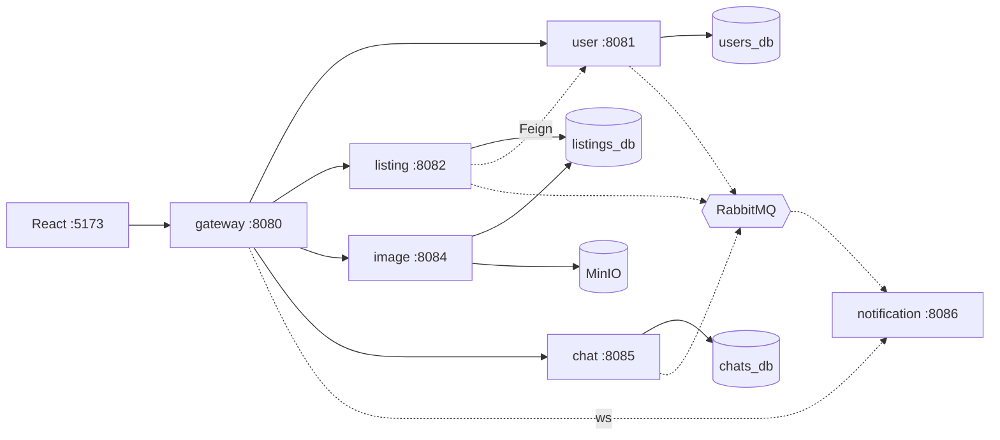

# Deala — маркетплейс объявлений


Учебный проект по дисциплине **«Конструирование программного обеспечения»** (ТПУ).

Площадка для размещения объявлений: пользователь регистрируется, публикует объявления
с фотографиями, просматривает каталог, переписывается с продавцом и получает уведомления
в реальном времени.

Бэкенд собран из шести независимых Spring Boot-сервисов, объединённых API-шлюзом,
шиной событий RabbitMQ и объектным хранилищем MinIO. Фронтенд — SPA на React.

---

## Возможности

**Пользователи**

- Регистрация и вход по email, пароли хранятся в виде BCrypt-хэша.
- JWT (HS256, 24 часа), роли `ROLE_USER` / `ROLE_ADMIN`.
- Профиль: имя, телефон, город, рейтинг, аватар.

**Объявления**

- Создание, редактирование и удаление — только владельцем.
- Каталог с ценой, описанием, продавцом и фотографиями.
- До 10 изображений на объявление: оригинал в MinIO + оптимизированная копия
  (ширина 1200 px, JPEG q = 0.80).

**Чат**

- Переписка покупателя и продавца в разрезе объявления.
- Список диалогов «покупаю» / «продаю», история сообщений, удаление переписки.

**Уведомления**

- WebSocket/STOMP через шлюз: `/ws-notifications`.
- События о создании/изменении/удалении объявления и о новых сообщениях.
- В интерфейсе — всплывающие уведомления и индикатор непрочитанного.

---

## Архитектура



| Сервис | Порт | Ответственность | Хранилище |
| --- | --- | --- | --- |
| `gateway-service` | 8080 | Единая точка входа, маршрутизация, проверка JWT, CORS, WebSocket-прокси | — |
| `user-service` | 8081 | Регистрация/вход, выдача JWT, профили, роли | `users_db` |
| `listing-service` | 8082 | CRUD объявлений, каталог, события для уведомлений | `listings_db` |
| `image-service` | 8084 | Загрузка файлов, ресайз, хранение в MinIO | `listings_db` + MinIO |
| `chat-service` | 8085 | Комнаты и сообщения чата | `chats_db` |
| `notification-service` | 8086 | RabbitMQ → STOMP-топики `/topic/notifications.{userId}` | — |
| `frontend` | 5173 | Каталог, карточка, создание/редактирование, профиль, чаты | `localStorage` |

Инфраструктура: три PostgreSQL (`5435`, `5433`, `5434`), RabbitMQ (`5672`, веб-консоль `15672`),
MinIO (`9000`, консоль `9001`).

**Как проходит запрос.** React обращается к шлюзу, тот проверяет JWT и добавляет заголовки
`X-User-Id` / `X-User-Roles`; внутренние сервисы доверяют этим заголовкам и не разбирают
токен повторно. Всё, что можно сделать асинхронно — уведомления и привязка фотографий, —
идёт через RabbitMQ: `listing-service` и `chat-service` публикуют события, `notification-service`
рассылает их подписчикам.

---

## Технологии

| Слой | Стек |
| --- | --- |
| Бэкенд | Java 21, Spring Boot 3.3, Spring Cloud Gateway 2023.0.2, Spring Security, Spring Data JPA, OpenFeign, Lombok |
| Аутентификация | JWT (JJWT 0.12.5), BCrypt |
| Данные | PostgreSQL 16, Liquibase, RabbitMQ 3, MinIO (S3) |
| Фронтенд | React 19, React Router 7, Vite 8, Axios, STOMP-клиент, react-toastify |
| Инфраструктура | Docker, Docker Compose, multi-stage сборка Java-образов |

---

## Быстрый старт

### Что нужно

Только **Docker Desktop** с Compose V2 — JDK, Maven и Node на хосте не требуются.

### 1. Клонирование и запуск

```bash
git clone https://github.com/embv86/tpu-software-development.git
cd tpu-software-development
docker compose up --build -d
```

Первая сборка может занять 5–15 минут: Maven скачивает зависимости и собирает образ
для каждого сервиса. Проверить состояние:

```bash
docker compose ps
docker compose logs -f gateway-service
```

Все значения конфигурации лежат в `.env` и уже рабочие — менять ничего не нужно.
Если порт занят, поправьте соответствующий `*_PORT` в `.env` и перезапустите.

### 2. Адреса

| Что | Адрес | Доступ |
| --- | --- | --- |
| Приложение | <http://localhost:5173> | регистрация на странице «Профиль» |
| API (шлюз) | <http://localhost:8080/api/v1> | JWT |
| RabbitMQ Management | <http://localhost:15672> | `guest` / `guest` |
| MinIO Console | <http://localhost:9001> | `minioadmin` / `minioadmin` |
| PostgreSQL пользователей | `localhost:5435` | `postgres` / `postgres` |
| PostgreSQL объявлений | `localhost:5433` | `postgres` / `postgres` |
| PostgreSQL чатов | `localhost:5434` | `postgres` / `postgres` |

### 3. Проверка

1. Откройте <http://localhost:5173> — загрузится пустой каталог.
2. Зарегистрируйтесь: «Профиль» → форма входа.
3. Создайте объявление с фотографиями — оно появится в каталоге, а справа сверху
   всплывёт уведомление.
4. Откройте объявление из второго аккаунта и напишите продавцу: сообщение придёт
   в чат и всплывёт уведомлением.

Демо-данные одним скриптом (Windows/PowerShell):

```powershell
powershell -ExecutionPolicy Bypass -File .\simulate.ps1
```

Скрипт регистрирует трёх пользователей с паролем `password123`, создаёт 15 объявлений
и имитирует переписку по первым трём.

### Остановка

```bash
docker compose stop     # остановить
docker compose down     # удалить контейнеры, данные в ./data сохранятся
docker compose down -v  # удалить и именованные тома
```

Изменения во фронтенде подхватываются на лету: каталог `./frontend` смонтирован
в контейнер, Vite работает в режиме hot-reload. После правок Java-кода нужен
`docker compose up --build -d`.

---

## Конфигурация

Все параметры задаются через `.env` в корне репозитория:

| Переменная | По умолчанию | Назначение |
| --- | --- | --- |
| `JWT_SECRET` | hex-строка | Секрет подписи токена, общий для `user-service` и шлюза |
| `GATEWAY_SERVICE_PORT` | `8080` | Порт API-шлюза |
| `USER_SERVICE_PORT` / `LISTING_SERVICE_PORT` | `8081` / `8082` | Порты сервисов |
| `IMAGE_SERVICE_PORT` / `CHAT_SERVICE_PORT` / `NOTIFICATION_SERVICE_PORT` | `8084` / `8085` / `8086` | Порты сервисов |
| `FRONTEND_PORT` | `5173` | Порт Vite |
| `POSTGRES_USERS_PORT` / `_LISTINGS_PORT` / `_CHATS_PORT` | `5435` / `5433` / `5434` | Порты БД на хосте |
| `RABBITMQ_USER` / `_PASSWORD` | `guest` / `guest` | Доступ к RabbitMQ |
| `MINIO_ROOT_USER` / `_PASSWORD` | `minioadmin` / `minioadmin` | Доступ к MinIO |
| `MINIO_BUCKET_RAW` / `_PROCESSED` | `raw-images` / `market-images` | Бакеты оригиналов и обработанных фото |

Внутри контейнеров адреса переопределены в `docker-compose.yml`
(`SPRING_DATASOURCE_URL`, `SPRING_RABBITMQ_HOST` и т. д.).

---

## API

Все запросы идут через шлюз: `http://localhost:8080/api/v1`.

| Метод | Путь | Доступ |
| --- | --- | --- |
| `POST` | `/auth/register`, `/auth/login` | публичный |
| `GET` | `/users/{id}` | публичный |
| `PUT` | `/users/me` | JWT |
| `GET` | `/listings`, `/listings/{id}` | публичный |
| `POST` `PUT` `DELETE` | `/listings`, `/listings/{id}` | JWT |
| `POST` | `/images/upload` — `multipart/form-data`, поле `files`, до 10 файлов | JWT |
| `POST` `GET` `DELETE` | `/chats/send`, `/chats/history`, `/chats/rooms`, `/chats/{id}` | JWT |
| `WS` | `/ws-notifications` — STOMP, топик `/topic/notifications.{userId}` | — |

Пример: регистрация и создание объявления.

```bash
curl -X POST http://localhost:8080/api/v1/auth/register \
  -H "Content-Type: application/json" \
  -d '{"email":"student@tpu.ru","password":"password123","firstName":"Иван"}'

# ответ: {"token":"eyJ...","id":1,"email":"student@tpu.ru","roles":["ROLE_USER"]}

TOKEN="eyJ..."
curl -X POST http://localhost:8080/api/v1/listings \
  -H "Authorization: Bearer $TOKEN" \
  -H "Content-Type: application/json" \
  -d '{"title":"Учебник по КПО","description":"Состояние отличное","price":750,"imageIds":[]}'
```

---

## Структура репозитория

```
├── gateway-service/        # маршрутизация, JWT-фильтр, CORS
├── user-service/           # аутентификация, профили, роли
├── listing-service/        # объявления, каталог, миграции Liquibase
├── image-service/          # загрузка и обработка изображений, MinIO
├── chat-service/           # чаты и сообщения
├── notification-service/   # RabbitMQ → WebSocket
├── frontend/               # React + Vite
├── docker-compose.yml      # инфраструктура, сервисы, фронтенд
├── Dockerfile              # multi-stage сборка (ARG SERVICE_NAME)
├── simulate.ps1            # наполнение демо-данными через API
└── .env                    # порты и учётные данные
```

Каждый сервис построен по схеме `controller → service → repository → entity` с отдельным
DTO-слоем. Схема `users_db` и `listings_db` версионируется Liquibase; `chats_db` создаётся
Hibernate.
